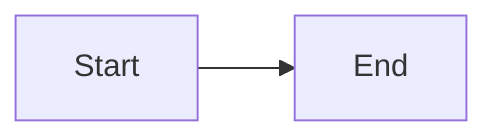
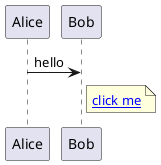

# MarkdownX live smoke test

## Mermaid



## PlantUML



Class diagrams need a layout engine; servers usually have no Graphviz.

```plantuml
class Order {
  +total()
}
class Line
Order *-- Line
```

## Math

```math
E = mc^2 + \href{javascript:alert('xss-katex')}{click}
```

Inline math: $a^2 + b^2 = c^2$.
Prices are text, not math: $5 and $10.
